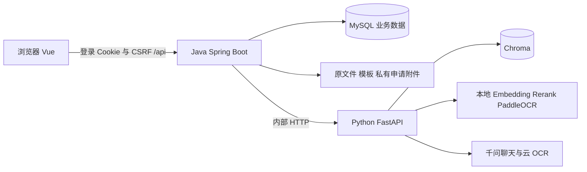

# CampusAgent

CampusAgent 是一个校园事务问答与办事引导项目。目前实现了政策资料入库、带来源的 RAG 问答、结构化办事指南，以及项目内的申请、补交和管理员审核流程。学生可以查政策、下载材料模板、保存对话和评价回答；管理员负责维护知识库、事项和申请记录。

本项目由 AIC 海底小纵队开发与维护。这里介绍当前代码已经实现的内容，学校政策、办理要求和实际审批结果仍需由资料维护者核实。

## 当前功能

| 模块 | 已实现的内容 | 使用边界 |
| --- | --- | --- |
| 登录与权限 | MySQL 账号、BCrypt、JWT HttpOnly Cookie、可撤销会话、CSRF、STUDENT/ADMIN 角色 | 账号通过工具和 SQL 维护，没有注册、学校统一身份认证或后端自助改密接口 |
| 知识库 | 上传、SHA-256 去重、异步解析、处理进度、重命名、重新解析、删除 | 当前管理一个配置的知识库；没有政策发布版本、生效日期和旧版本过滤 |
| 问答与检索 | 向量召回、CrossEncoder 重排、时间证据校验、问题改写、答案及来源 | 生成依赖千问；来源表示进入 Context 的片段，不等于逐句事实验证 |
| 办事引导 | 事项识别、查询意图分流、条件、材料、步骤、部门与来源 | 明确匹配流程时可在 AI 失败后返回数据库指南；模糊表达仍可能依赖 AI |
| 准备清单 | 按账号和事项保存材料勾选、步骤推进、回退、重置 | 保存在浏览器，不能代替申请审核，不跨设备同步 |
| 在线申请 | 必交材料逐项校验、要求快照、附件、补交、状态和事件历史 | 是 CampusAgent 内部流程，未对接学校审批系统；页面附件下载地址有已知不一致 |
| 聊天记录 | 新建、恢复、切换、删除、请求去重、重新生成 | 后端按当前用户隔离；学生主动登录后先进入空白对话，历史可手动打开 |
| 分享与反馈 | 消息多选、Canvas 图片导出、公开只读链接、评价和质量分析 | 分享固定创建时的消息范围；质量分析另需数据库授权 |
| 个人资料与管理视图 | 主题切换、个人资料、概览、审计追溯视图、只读设置 | 空资料有虚构展示兜底；审计页汇总现有记录，没有独立审计日志或导出接口 |

各功能的接口、数据和验收步骤见 [文档索引](docs/README.md)。

## 技术栈与目录

前端依赖以 [package.json](frontend/package.json) 和锁文件为准：Vue 3.5.42、Vue Router 5.3.1、Vite 8.3.0、TypeScript 6.0.3。当前使用原生 fetch，没有 Element Plus 或 Axios。

Java 使用 JDK 21、Spring Boot 3.5.16、Spring Security 和 MySQL。项目引入 MyBatis-Plus 3.5.17，但当前业务 Repository 主要通过 JdbcTemplate 执行参数化 SQL。Python 使用 FastAPI、pypdf、PDFium、PaddleOCR、Sentence Transformers、Chroma 和 httpx，版本见 [requirements.txt](ai-service/requirements.txt)。

```text
frontend/
  src/components/              Vue 页面外壳、登录、问答和个人菜单
  src/workspace/               API 调用、各业务视图及交互
  src/modules/serviceguide/    TypeScript 准备进度模型
  tests/                       单元及浏览器回归
backend/
  campus-app/                  唯一启动模块、知识库管理、SQL 和集成测试
  campus-identity/             认证、账号、会话及本地账号工具
  campus-affair/               事项、模板附件、申请和审核
  campus-ai-integration/       AI 客户端、问答编排、历史、分享和评价
  campus-shared/               响应、异常、UUID 文件存储
  campus-policy/               预留模块
  campus-question/             预留模块
  campus-audit/                预留模块
ai-service/
  app/api/                     内部 HTTP 接口
  app/core/                    配置和依赖装配
  app/services/                解析、切块、检索、证据过滤和问答编排
  app/infrastructure/          OCR、PDF、DOCX、模型适配
  app/llm/                     千问 Provider 和 Prompt
  app/vector_store/            向量库抽象与 Chroma 实现
docs/                          功能说明和开发检查记录
scripts/                       启动、账号、验收与资料维护工具
deploy/                        部署说明，尚无容器或反向代理配置文件
```



三个应用进程分别启动；Java 后端内部是模块化单体，并非每个 Maven 模块各起一个服务。Python 不访问业务 MySQL，浏览器业务请求只发给 Java。

## 环境与启动

需要 Node.js 满足 `frontend/package.json` 的 `>=20.19.0` 声明、JDK 21、Maven、MySQL 8 和 Python。本文给出 Python 3.12 的 Windows 命令；其他 Python 版本与平台的依赖安装兼容性待确认，不沿用旧文档中未经本次验证的完整版本区间。

完整的新环境准备、JWT 密钥、旧库升级、账号初始化和手工验收统一放在 [启动说明](docs/service-application-startup.md)。已有环境可在三个独立 PowerShell 窗口执行以下命令，均从仓库根目录开始：

```powershell
# 窗口一：先核对 backend/.env 的数据库连接和 JWT_SECRET
powershell -NoProfile -ExecutionPolicy Bypass -File .\scripts\start-backend.ps1 -Build
```

```powershell
# 窗口二：已创建虚拟环境并安装依赖
Set-Location ai-service
.\.venv\Scripts\python.exe -m uvicorn app.main:app --host 127.0.0.1 --port 8000
```

```powershell
# 窗口三
Set-Location frontend
npm ci
npm run dev -- --host 127.0.0.1 --port 5173 --strictPort
```

后端启动脚本读取 `backend/.env`；直接 `java -jar` 不会自动读取它。Python Settings 从当前工作目录读取 `.env`，因此在 `ai-service` 目录运行。首次复制环境模板时应保留已有文件：

```powershell
if (!(Test-Path backend/.env)) { Copy-Item backend/.env.example backend/.env }
if (!(Test-Path ai-service/.env)) { Copy-Item ai-service/.env.example ai-service/.env }
```

Windows 还可双击 `frontend/start.bat` 或 `frontend/启动.bat`。脚本会尝试启动缺失的后端和 AI 服务，但不会安装 Python 依赖、创建数据库或生成 JWT 密钥；已有 JAR 默认会被复用。仅启动前端使用 `powershell -File frontend/start.ps1 -FrontendOnly`。详见 [前端说明](frontend/README.md)。

## 页面和接口地址

当前前端使用 Vue Router 的 hash 路由，地址是 `http://127.0.0.1:5173/#/...`。登录是同一应用中的界面状态，没有独立的 `/login` 路由。

| 页面 | 路径 |
| --- | --- |
| 智能问答 | `/#/qa` |
| 事务概览 | `/#/dashboard` |
| 政策检索、办事引导 | `/#/search`、`/#/affairs` |
| 我的申请 | `/#/my-applications` |
| 管理员政策、事项管理 | `/#/policy-mgr`、`/#/services-mgr` |
| 申请审核、质量分析 | `/#/review`、`/#/ai-quality` |
| 审计追溯、只读设置 | `/#/audit`、`/#/settings` |
| 公开分享 | `/#/share/<token>` |

Java 健康接口：`GET http://127.0.0.1:8080/api/v1/health`。AI 健康接口：`GET http://127.0.0.1:8000/internal/v1/health`，开发文档：`http://127.0.0.1:8000/docs`。健康响应只说明进程能够响应，不证明模型、索引或云接口可用。Java 没有 Swagger 配置。

## 核心业务流程

管理员上传政策资料后，Java 保存 UUID 原文件和 MySQL 元数据，通过最多 2 个工作线程和 16 个排队任务调用 Python。Python 根据文件类型提取文字，PDF 仅对文本不足的页执行 OCR，再清洗、切块、批量生成向量并写入 Chroma。前端约每 2 秒轮询 Java 进度；最终成功由 Java 写入 MySQL 后确认。

知识库允许 PDF、DOCX、TXT、MD、XLSX、PPTX、PNG、JPG/JPEG，默认单文件 20 MB。模板附件允许 DOC、DOCX、PDF、XLS、XLSX、ZIP；学生申请附件允许 PDF、DOC、DOCX、PNG、JPG/JPEG。三类用途和白名单不能混用，模板与申请材料均不进入 RAG。

发送问题时，Java 先保存用户消息，从数据库取最近最多 8 条上下文，再判断事项和查询意图。资格、政策与普通咨询走 RAG；只有有效事项匹配且意图为 `SERVICE_GUIDE` 才返回数据库流程卡片。Python 的问题改写只用于检索，最终回答使用本轮问题和本轮 Context，历史回答不作为政策证据。

Java 问答请求示例：

```json
{
  "query": "需要准备哪些材料？",
  "knowledgeBaseId": "campus-default",
  "conversationId": 12,
  "requestId": "5a4d68f0-106e-4a2c-beba-9e7658748a11"
}
```

先用 `POST /api/chat/conversations` 获取自己的实际会话 ID；每次新问题用新的 UUID，重试同一请求才复用。旧 `history` 字段虽仍被 DTO 接受，公共接口实际只使用数据库历史。省略会话 ID 会新建会话。具体响应和并发规则见 [聊天历史](docs/chat-history.md)。

申请从已启用事项进入弹窗，身份取登录账号，必交材料在 Java 逐项校验并保存要求快照；管理员审核和学生补交写入状态事件。该流程没有调用外部学校系统。详见 [在线申请](docs/service-application.md)。

## 数据和当前限制

MySQL 保存账号、文档元数据、事项、申请、聊天、分享及反馈，共 20 张表。SQL、约束和迁移顺序见 [后端说明](backend/README.md)。新库自动建表；很早的旧库若缺少 OCR 进度字段，需要先人工核对 V2，不能直接把所有迁移文件重复执行。

默认运行数据：`backend/var/documents`（含 `materials` 和 `applications` 子目录）、`ai-service/var/chroma`。前者相对于 Java 工作目录；后者由 Python 代码相对于 AI 服务根目录解析。启动方式变化时应核对路径，部署与备份见 [部署说明](deploy/README.md)。

目前没有政策版本治理、关键词与向量混合检索、流式生成、跨设备准备清单、复杂审批引擎、独立审计系统或经验证的生产部署包。前端改密契约、私有申请附件链接及知识库范围限制见 [检查记录](docs/README.md#文档检查与待确认项)。真实学校资料、云模型质量、性能与试点成果需单独验证。

## 验证

```powershell
# frontend 目录
npm test
npm run build
npm run test:browser

# backend 目录
mvn test

# ai-service 目录
.\.venv\Scripts\python.exe -m pip install -r requirements-dev.txt
.\.venv\Scripts\python.exe -m pytest -q --basetemp ../tmp/pytest-campus
```

浏览器回归使用 Playwright Core、浏览器和拦截的 API；Java 集成测试使用 H2；Python 多数模型与云接口测试使用替身。它们不能代替真实 MySQL、云 OCR、千问答案及新环境部署验收。本次文档核对的实际检查结果集中记录在 [文档索引](docs/README.md)，其他功能文档保留可重跑步骤，不重复写不同阶段的测试总数。
