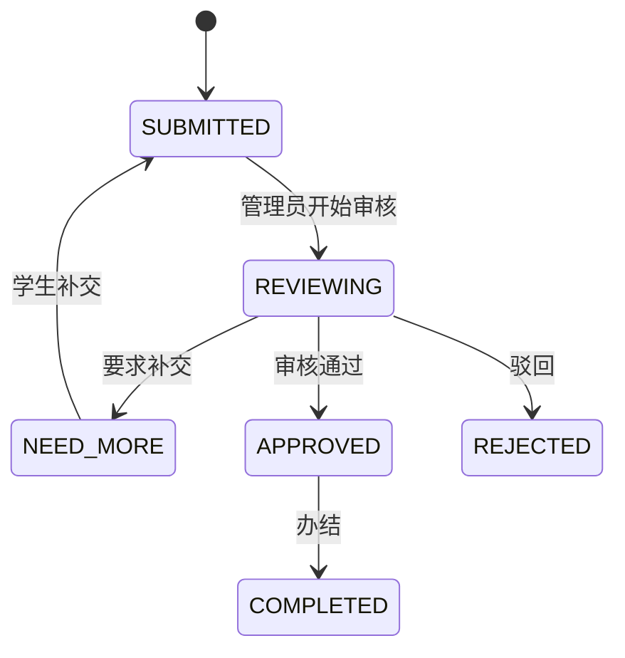

# CampusAgent 在线申请与审核

目前实现项目内的学生申请、必交材料上传、要求快照、补交、管理员审核和事件记录。学生入口 /#/my-applications 或问答卡片的立即办理；管理员 /#/review。创建、详情、补交和审核为弹窗，没有旧 apply/detail 页面路由。

申请材料只进入 Java 文件存储和 MySQL，不传到 Python，不进入政策知识库。流程在 CampusAgent 中运行，未对接学校正式审批系统。

## 数据和提交

V6 创建 service_application、service_application_attachment、service_application_event；V10 创建 service_application_material、service_application_attachment_material，均随当前 SQL Init 启动建表。

申请保存事项名称、登录用户 ID、姓名/学号、申请说明、状态、最新审核意见、version、提交/更新时间及办结时间。编号为 CA + 上海日期 yyyyMMdd + 至少 8 位数据库自增 ID，ID 不按日重置，允许间断，不是前端生成。

材料要求快照包含稳定 materialId、名称、描述和 required。新申请按提交时目录复制，以后事项变化不改旧申请补交要求；旧申请无快照时不从当前目录反推，只保留普通补交兼容。当前不是完整的事项/政策版本快照。

创建请求的身份取当前登录账号，服务端只接受 ACTIVE 事项、已有学号和非空说明。前端逐项选择材料，后端 MaterialSubmissionValidator 再核对材料归属、文件/分类数量、必交项覆盖。格式合法和已上传不等于材料内容通过审核。

## 状态与并发

SUBMITTED、REVIEWING、NEED_MORE、APPROVED 均占用 active_slot=1；REJECTED 和 COMPLETED 为 NULL。同一学生同一事项最多一个在办申请，事项行锁及唯一键共同防并发重复。

审核和补交锁定申请并验证 version；旧页面返回 409。单步 /status 只允许图中一条边，统一 /review 可以在同一事务沿合法路径走到目标，如已提交 → 审核中 → 已通过 → 已办结，每一步记录事件，意见只写最终一步。不能跳过路径直接改表状态。

补交仅 NEED_MORE，至少一个新附件和非空说明，回到 SUBMITTED，旧附件及事件保留。申请/审核意见最多 4000 字符；要求补交和驳回必须写原因。驳回/办结终止本申请，可再创建新申请；没有撤回、取消或多部门审批引擎。

有申请记录的事项不能硬删除，应停用。停用不接受新申请，历史申请仍可读取和审核。

## API

| 方法 | 路径 | 参数与返回 |
| --- | --- | --- |
| GET | /api/student/applications/upload-config | 单文件/总量/数量/类型限制 |
| GET | /api/student/applications/active?serviceItemId=N | 本人该事项在办申请，没有为 null |
| GET | /api/student/applications | status/page/pageSize，本人记录 |
| GET | /api/student/applications/{id} | application、attachments、events、materials |
| POST | /api/student/applications | multipart serviceItemId、studentRemark、重复 files/materialIds |
| POST | /api/student/applications/{id}/resubmit | multipart version、studentRemark、重复 files/materialIds |
| GET | /api/student/applications/attachments/{id}/download | 学生私有材料下载 |
| GET | /api/admin/applications、/{id} | ADMIN 全部申请/详情 |
| PATCH | /api/admin/applications/{id}/status | 单步 JSON status/remark/version |
| PATCH | /api/admin/applications/{id}/review | 统一审核 JSON status/remark/version |
| GET | /api/admin/applications/attachments/{id}/download | ADMIN 私有材料下载 |

列表默认 page=1/pageSize=10，最多 100；status 可为六种精确状态或 ACTIVE。在界面当前默认每页 20。materialIds 与 files 按位置对应，空字符串表示其他附件。无必交要求可以不上传；有必交要求时旧无分类请求不能绕过。

学生只创建/读取本人申请，管理员不能使用学生创建接口。学生读取他人申请/附件返回 403，不存在返回 404；重复在办、非法状态和旧版本为 409；匿名 401，写请求需 CSRF。管理员当前有全校申请范围，没有部门分派权限。

## 附件与已知页面问题

允许 PDF、DOC、DOCX、PNG、JPG/JPEG；默认单文件 20 MB，复用 ADMIN_MAX_UPLOAD_SIZE_MB，每次最多 10 个/总计 100 MB，每份申请最多 50 个。浏览器 MIME 必须匹配或为 application/octet-stream，再按签名确认；拒绝路径字符、..、控制字符及非法文件名，Office 复用模板验证器。

默认保存 backend/var/documents/applications（以仓库启动脚本工作目录为准），可由 APPLICATION_UPLOAD_DIR 覆盖。UUID 作为磁盘文件名，关联元数据在数据库，事务回滚清理本次新文件；异常终止可能留孤立文件，没有清理任务。下载需先核对申请归属，响应 attachment、nosniff、no-store，不开放静态目录。

**当前前端申请详情和审核中的附件按钮存在路径不一致。** workspace.js 的 showApplicationDetail 和管理员详情把申请附件 ID 拼到 /api/files/{id}/download 或 /api/admin/files/{id}/download；这两个接口查询的是模板表。实际申请材料应使用上表的 /applications/attachments/{id}/download。正确后端接口已实现，页面按钮真实下载需修复并复验，本次只更新文档，未改代码。

模板下载与申请私有附件不能混用。自动浏览器夹具没有证明该真实下载路径正常。

## 手工验收和自动覆盖

按 [完整启动](service-application-startup.md) 准备账号、启用事项及三个应用。创建含两项必交要求的独立测试事项：缺一项阻止提交，全部对应后创建，重复在办提示；管理员要求补交后修改事项材料，旧申请仍用原快照；学生补交回到已提交；管理员统一审核办结后核对完整事件和新申请资格。两个编辑窗口旧 version 应 409，两个学生不能互读附件。

自动覆盖为 ApplicationIntegrationTest（H2、模拟边界、临时文件）和 frontend/tests/browser/workspace.application-materials.e2e.mjs、workspace.application-review.e2e.mjs。标准运行命令见 [总览](../README.md#验证)。旧 serviceApplication.e2e.mjs/applicationInteractions.e2e.mjs 及临时 run-auth-browser.ps1 不是当前仓库入口。

本次没有重新验收真实 MySQL、学校流程或附件页面下载。前端构建及部分单元测试结果集中在 [检查记录](README.md#本次检查与验证)，不沿用早期双前端的通过数字。仍待实现学校接口、多部门权限、撤回、消息提醒、材料内容自动核验和完整政策依据快照。
